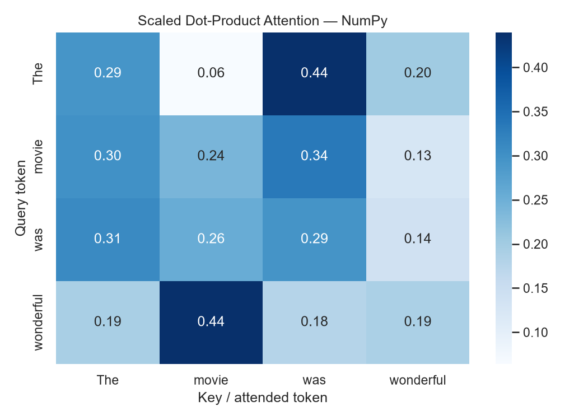
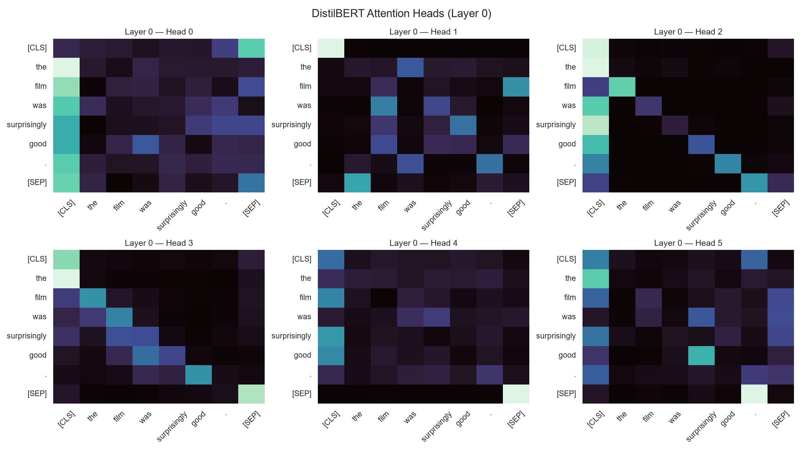
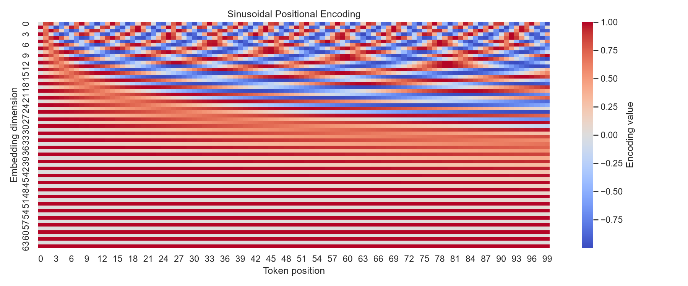
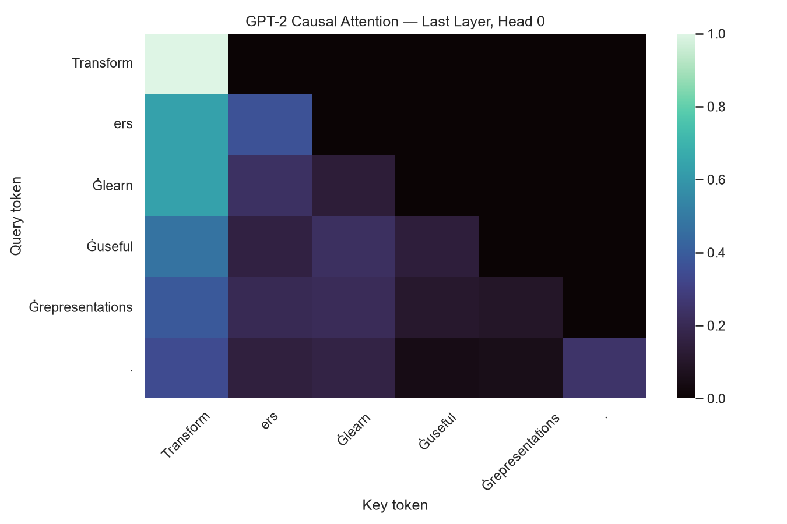
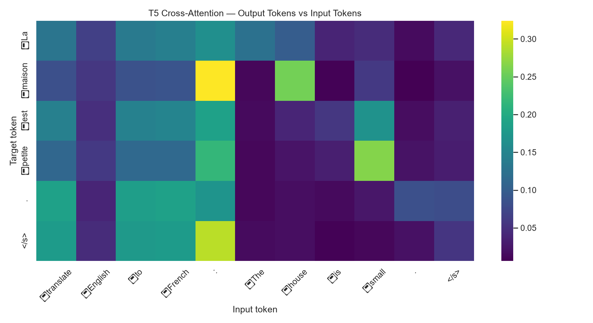
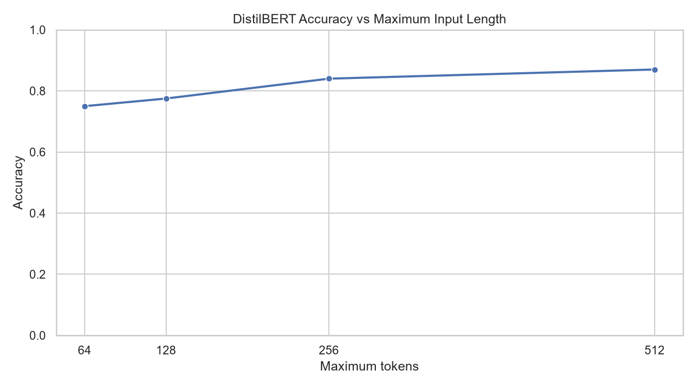
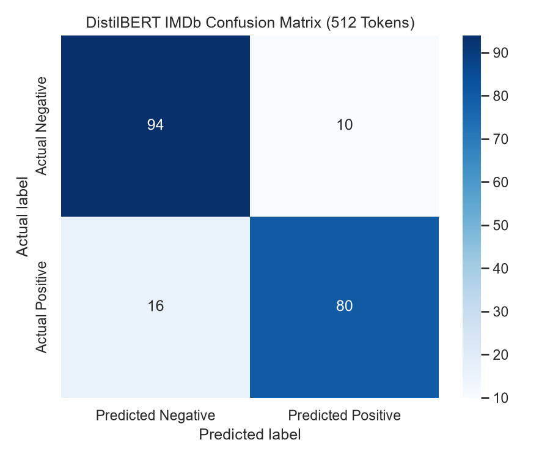
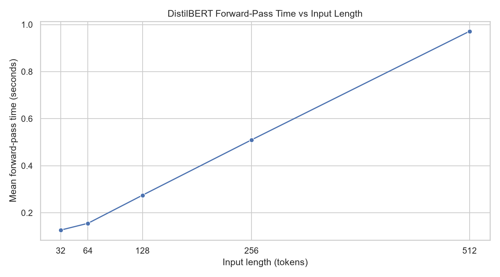

# 🧠 Opening the Transformer: Attention, Encoder, Decoder & Inference


> **Deep Learning Practical Report 6 — Red & White Skill Education**

A hands-on exploration of Transformer models using NumPy, PyTorch and Hugging Face Transformers. The practical implements attention calculations from scratch, visualises attention patterns from pretrained models, compares encoder-only, decoder-only and encoder–decoder architectures, and evaluates sentiment classification on IMDb reviews.

**Important:** This project uses pretrained models for inference. No model is trained or fine-tuned.

---

## 📑 Table of Contents

- [Project Overview](#-project-overview)
- [Objectives](#-objectives)
- [Models and Dataset](#-models-and-dataset)
- [Practical Workflow](#-practical-workflow)
- [Key Visualizations](#-key-visualizations)
- [Evaluation](#-evaluation)
- [Mini Application](#-mini-application)
- [Tools and Technologies](#️-tools-and-technologies)
- [Installation and Usage](#-installation-and-usage)
- [Project Structure](#-project-structure)
- [Limitations and Practical Observations](#-limitations-and-practical-observations)
- [Project Demonstration](#-project-demonstration)
- [Author](#-author)

---

## 📌 Project Overview

Transformers use attention to model relationships between tokens in a sequence. This practical studies the mathematics behind attention and examines how different Transformer architectures process and generate text.

The complete work is organised into six tasks in **`DL_PR6.ipynb`**:

1. Introduction, history, pipelines and tokenisation
2. Self-attention and scaled dot-product attention
3. Multi-head attention, positional encoding and Layer Normalization
4. Encoder architecture and masked self-attention
5. Cross-attention, decoder architecture and inference
6. Evaluation, mini application and practical disadvantages

---

## 🎯 Objectives

- Understand tokenisation, pretrained pipelines and the development of Transformers.
- Implement scaled dot-product attention and Luong attention using NumPy.
- Inspect real attention heads, positional information, parameter distribution and Layer Normalization.
- Compare bidirectional encoder attention, causal decoder masking and encoder–decoder cross-attention.
- Explore translation, summarisation, greedy decoding, beam search, sampling and KV caching.
- Evaluate sentiment predictions on a reproducible sample of 200 IMDb test reviews.
- Measure how truncation length affects sentiment accuracy and inference time.
- Test factual generation and build a reusable text-processing toolkit.

---

## 🤖 Models and Dataset

### Pretrained models

| Purpose | Model |
|---|---|
| Sentiment analysis and encoder attention | `distilbert-base-uncased-finetuned-sst-2-english` |
| Causal attention and text generation | `gpt2` |
| Translation, summarisation and cross-attention | `t5-small` |

The models are downloaded from Hugging Face and cached locally on first use. Internet access is therefore required for the initial download.

### IMDb evaluation sample

- **Source:** Public IMDb dataset through the Hugging Face `datasets` library.
- **Split:** `test`
- **Sample size:** 200 reviews
- **Sampling:** Shuffled with seed `42` for reproducibility.
- **Labels:** `0 = Negative`, `1 = Positive`

The notebook also uses three text passages for the translation, summarisation and text-toolkit demonstrations.

---

## 🔄 Practical Workflow

| Task | Main activities |
|---|---|
| **Task 1 — Introduction** | Explore sentiment pipelines, Transformer history, tokenisation, batching, padding and model anatomy. |
| **Task 2 — Self-attention** | Implement scaled dot-product and Luong attention; verify the NumPy calculation against DistilBERT. |
| **Task 3 — Multi-head attention** | Visualise attention heads and entropy, create sinusoidal positional encodings, inspect learned position embeddings and compare LayerNorm implementations. |
| **Task 4 — Encoder and masking** | Inspect bidirectional attention, construct a causal mask in NumPy and visualise GPT-2 causal attention. |
| **Task 5 — Decoder and inference** | Explore T5 cross-attention, translation, summarisation, manual greedy decoding, decoding strategies and KV-cache timing. |
| **Task 6 — Evaluation** | Evaluate 200 IMDb reviews, compare truncation limits, plot accuracy and timing, inspect the confusion matrix, test factual generation and run the text toolkit. |

---

## 📊 Key Visualizations

The notebook saves its plots in `plots/`. Run the relevant notebook cells to generate or refresh these files.

### 1. Scaled Dot-Product Attention



**Interpretation**
- Each row shows how a query token distributes attention across the available key tokens.
- Softmax normalises the scores into attention weights, so each row sums to approximately one.

### 2. Attention Heads



**Interpretation**
- Different attention heads can assign different weights to token relationships in the same input.
- The visualisation is an example from a pretrained model; it should not be treated as a universal explanation of every prediction.

### 3. Sinusoidal Positional Encoding



**Interpretation**
- The repeating colour patterns show how positions are represented across embedding dimensions.
- Positional information helps a Transformer distinguish token order, which self-attention alone does not encode inherently.

### 4. GPT-2 Causal Attention



**Interpretation**
- The triangular pattern shows that each token can attend only to its current and earlier positions.
- The causal mask blocks future tokens, allowing GPT-2 to generate text autoregressively.

### 5. T5 Cross-Attention



**Interpretation**
- Decoder queries attend to representations produced by the encoder.
- The attention map illustrates how target-side tokens can use information from the source sequence.

### 6. IMDb Accuracy vs. Truncation Length



**Interpretation**
- The plot compares sentiment accuracy across the tested maximum token lengths.
- Longer inputs retain more review context but may increase inference cost; use the measured results from your notebook run.

### 7. IMDb Confusion Matrix



**Interpretation**
- The diagonal cells show correct negative and positive predictions; the off-diagonal cells show classification errors.
- Use the displayed counts to identify which class has more misclassifications in this run.

### 8. Forward-Pass Time vs. Input Length



**Interpretation**
- This plot measures how DistilBERT inference time changes with input length on the current device.
- The timing is hardware- and environment-dependent, so it should be reported as an observation rather than a universal benchmark.

---

## 📈 Evaluation

The notebook evaluates the pretrained sentiment classifier on the selected 200-review sample and reports:

- Accuracy
- Precision
- Recall
- F1-score
- Confusion matrix and classification report
- Accuracy at maximum lengths of **64, 128, 256 and 512 tokens**
- Evaluation and forward-pass timing across input lengths

Metric values and timing can vary with package versions, hardware and model execution. Report the values produced by your completed notebook rather than assuming a result in advance.

---

## 🧪 Mini Application

The notebook defines **`text_toolkit(text)`**, which combines the available pretrained models to return:

- A sentiment label and score
- A short summary
- A French translation of the summary

It is tested with a review, a news-style passage and a student-selected passage. The notebook also checks empty input and long input handling.

---

## 🛠️ Tools and Technologies

| Category | Tools |
|---|---|
| Programming language | Python |
| Data handling | Pandas, NumPy |
| Deep learning and tensors | PyTorch |
| Pretrained models and tokenisers | Hugging Face Transformers |
| Dataset loading | Hugging Face Datasets |
| Visualisation | Matplotlib, Seaborn |
| Evaluation metrics | Scikit-learn |
| Development environment | VS Code, Jupyter Notebook |
| Version control | Git and GitHub |

---

## 🚀 Installation & Usage

Clone the repository:

```bash
git clone https://github.com/PareeSojitra0803/Transformer_Attention_Explorer.git
```

Move into the project directory:

```bash
cd Transformer_Attention_Explorer
```

Install required libraries:

```bash
pip install -r requirements.txt
```

Open the project in VS Code and launch the notebook:

```bash
code .
```

Open:

```text
DL_PR6.ipynb
```

Select the Python kernel containing the required libraries.

Run all cells from top to bottom.

**Note:** An internet connection is required for the first download of the pretrained models and IMDb dataset.

To view the exported results, open:

```text
DL_PR6.html
```

Visualizations are available in the `plots/` directory.


---

## 📁 Project Structure

```text
Transformer_Attention_Explorer/
│
├── DL_PR6.ipynb
├── DL_PR6.html
├── README.md
├── requirements.txt
│
├── plots/
│   ├── task2_numpy_attention.png
│   ├── task3_attention_heads.png
│   ├── task3_attention_entropy.png
│   ├── task3_positional_encoding.png
│   ├── task3_learned_position_similarity.png
│   ├── task3_parameter_distribution.png
│   ├── task4_bidirectional_attention.png
│   ├── task4_numpy_causal_mask.png
│   ├── task4_gpt2_causal_attention.png
│   ├── task5_t5_cross_attention.png
│   ├── task6_accuracy_vs_length.png
│   ├── task6_evaluation_time_vs_length.png
│   ├── task6_confusion_matrix.png
│   └── task6_forward_time_vs_length.png
│
└── .gitignore
```

> **Note:** The plot files are generated by notebook execution. The `data/` directory is optional for this workflow because the IMDb sample is loaded directly through Hugging Face Datasets. Keep the required `plots/` directory and the generated outputs used by your submission.

---

## ⚠️ Limitations and Practical Observations

- **Context truncation:** Tokens beyond the selected maximum length are discarded and may contain useful sentiment information.
- **Inference latency:** Longer sequences can require more computation; measured timing depends on the device and runtime.
- **Hallucination:** Generated summaries and factual responses can be incorrect and should be verified before being treated as evidence.
- **Compute and memory:** Pretrained models require downloads, RAM and inference time, even though no training is performed.
- **Interpretability:** Attention maps show selected token relationships but do not fully explain why a model made a prediction.
- **Reproducibility:** Seeds help make sampling repeatable, but timing and some outputs may still vary across environments.

---

## 🎥 Project Demonstration

**Video link:** https://drive.google.com/file/d/1UhEr2uLUlo80s1LmWnxw047DvEh7VJYY/view?usp=sharing


---

## 👩‍💻 Author

***Paree Sojitra***  

- **GitHub:** [PareeSojitra0803](https://github.com/PareeSojitra0803)

---

⭐ *This practical demonstrates Transformer attention and inference through mathematical implementations, pretrained-model inspection and measured experiments.*
